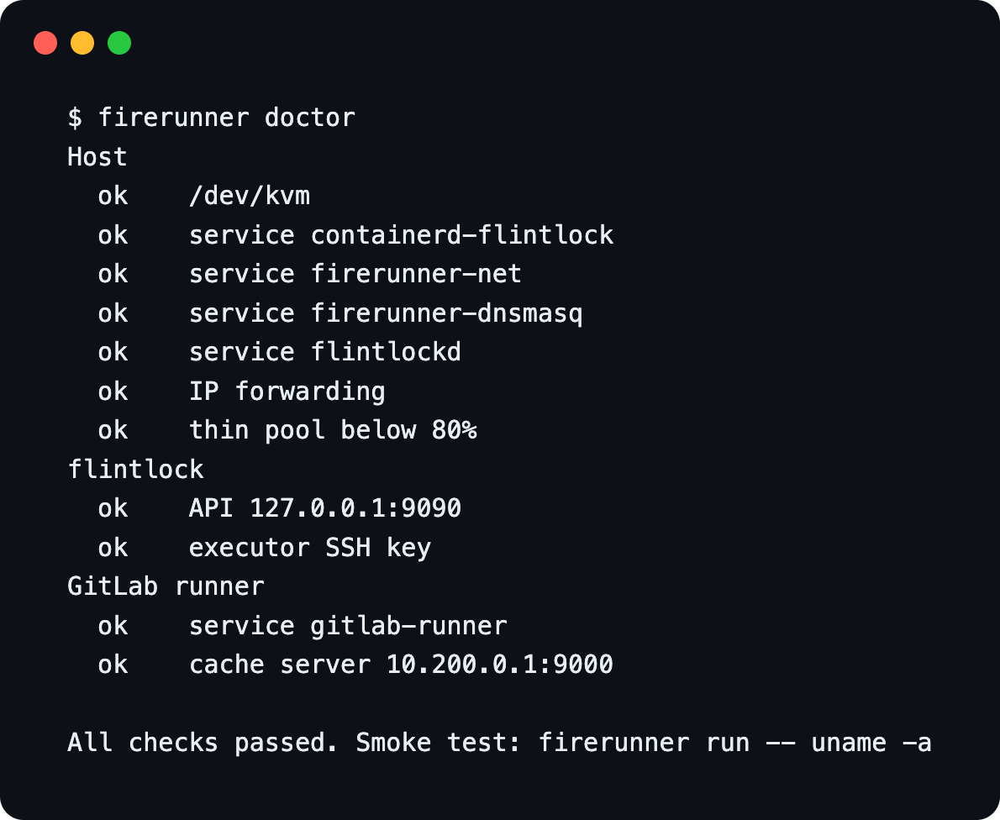

# Install

## Requirements

- x86_64 Linux with systemd and `/dev/kvm`. Tested on Rocky Linux 9.6 and Ubuntu 24.04.
- A blank disk for microVM disks, 100 GB or more. The installer wipes it.
- RAM for every microVM that runs at once, plus 1 GB for the host. With the defaults, 4 parallel
  jobs and 4 pool VMs (`FR_POOL_SIZE`) at 2 GB and up to 4 builders at 8 GB (`builder.max` ×
  `builder.memory_mb`), that is `((4 + 4) × 2 GB + 4 × 8 GB) × 1.05 + 1 GB`, about 51 GB. On a
  smaller host, lower `FR_POOL_SIZE`, `builder.max` or `builder.memory_mb`; see
  [Sizing a host](configuration.md#sizing-a-host). Jobs that do not fit wait for memory.
- Space on the host file system (not the blank disk) for saved builder caches in
  `/var/lib/firerunner/builder-cache`: up to `builder.saved_cache_gb` (100 GB), and never so much
  that the file system has less than 10% free.
- Space on the same file system for the registry mirrors: `FR_REGISTRY_GB`, by default a fifth of
  it. Their image takes all of it at install time (preallocated), and the installer refuses a size
  that would leave less than 10 % and 4 GB of the file system free (`auto` takes less instead);
  see [Registry mirrors](operations.md#registry-mirrors).
- GitLab 16 or newer.

On a VM host, turn on nested virtualization first:

- VMware: power off, then *Expose hardware assisted virtualization to the guest OS*.
- KVM or Proxmox: `kvm_intel nested=1` and CPU type `host`.

Check with `ls /dev/kvm`.

## Install

```bash
curl -sfL https://raw.githubusercontent.com/ismoilovdevml/firerunner/main/install.sh | sudo bash
```

The installer checks every download against its sha256, sets up the thin pool, the microVM
network, the image and cache servers and the services, then verifies them. You can run it again:
it only restarts what changed, and it reloads the microVM firewall in place without touching
running VMs.

Options go before `bash`, for example `sudo FR_DISK=/dev/sdb bash`:

| Variable | Default | |
|---|---|---|
| `FR_DISK` | the only blank disk | disk for microVM disks, wiped. Without it the installer takes a disk only when exactly one is blank (no partitions, signature, holders, mount or swap, first 1 MiB zero, 10 GB or more); otherwise it stops and asks for `FR_DISK` |
| `FR_VM_DISK` | `40GB` | root disk of each microVM, thin-provisioned |
| `FR_THIN_CHUNK` | `64K` | chunk size of a new thin pool: a VM's first write to a chunk copies or zeroes all of it; an existing pool keeps its size |
| `FR_POOL_SIZE` | `FR_RUNNER_CONCURRENT` | pre-booted microVMs; given on a re-run, it replaces `pool.size` |
| `FR_REGISTRY_MIRRORS` | `ghcr.io,quay.io,registry.k8s.io,mcr.microsoft.com` | registries mirrored on the host besides Docker Hub; remembered for later runs, `none` for none |
| `FR_REGISTRY_GB` | `auto` | most the registry mirrors store, in a file system of their own on the root disk, which takes all of it from the start (preallocated); `auto` is a fifth of the root file system, at least 5, less if 10 % and 4 GB of it would not stay free. Their eviction keeps 10 % or 1.5 GiB free at least, and frees up to 20 % and 3 GiB (at most half), so layers fill 2.5 to 3.5 GiB of 5, 7 to 8.5 GiB of 10, 80 to 90 % from 20 up ([Registry mirrors](operations.md#what-frees-space)). A larger value grows an existing one online if the root disk can spare it; a smaller one is not applied |
| `FR_VM_VCPU` | host CPUs / `FR_RUNNER_CONCURRENT`, 2 to 16 | vCPUs of each job microVM; given on a re-run, it replaces `vm.vcpu` |
| `FR_VERSION` | `edge` | firerunner release to install: `edge` (the latest `main`), `latest` (the newest release) or a version tag |
| `FR_ALLOW_UNSIGNED` | none | `1` installs v0.1.0 or v0.1.1, published before releases were signed. Every other release needs a valid signature |
| `FR_CACHE_DAYS` | `14` | `cache:` archives not written for this many days are deleted |
| `FR_CACHE_MAX_GB` | `auto` | above this size the oldest `cache:` archives are deleted (checked hourly); `auto` is a fifth of the file system holding the cache |
| `FR_METRICS_ALLOW` | none | CIDR that may scrape `:9477`; without it metrics stay local. Kept for later runs |
| `FR_EGRESS_DENY` | none | comma-separated CIDRs jobs must not reach, e.g. `192.168.0.0/16`. Kept for later runs; `none` clears it |
| `FR_GITLAB_URL`, `FR_RUNNER_TOKEN` | none | register the runner during install |
| `FR_RUNNER_CONCURRENT` | `4` | parallel jobs of the runner registered during install |
| `FR_SUBNET` | `10.200.0` | /24 for microVMs |
| `FR_BRIDGE` | `br-fc` | bridge the microVMs are attached to |
| `FR_PROXY`, `FR_NO_PROXY`, `FR_CA_FILE`, `FR_INSECURE_REGISTRIES` | none | behind a proxy or with internal registries: see [Corporate networks](corporate-network.md) |

## Connect GitLab

1. In GitLab, create a runner: *Settings → CI/CD → Runners → New runner* (project, group or
   instance). Tag: `firecracker`. Leave *Run untagged jobs* off.
2. Register it on the host:

    ```bash
    sudo firerunner runner register --url https://gitlab.example.com --token -   # paste the glrt-... token
    ```

3. Check:

    ```bash
    sudo firerunner doctor               # every check "ok"
    sudo firerunner run -- uname -a      # boots a throwaway microVM
    ```

For more hosts, install and register each one; GitLab spreads jobs over them.



## Uninstall

```bash
curl -sfL https://raw.githubusercontent.com/ismoilovdevml/firerunner/main/install.sh | sudo bash -s -- uninstall
```

It deletes the microVMs and removes services and binaries (containerd's binaries stay). The disk,
images, `/var/lib/firerunner` and `/etc/firerunner` stay; the command prints how to remove them.
Delete the runner in GitLab yourself.
