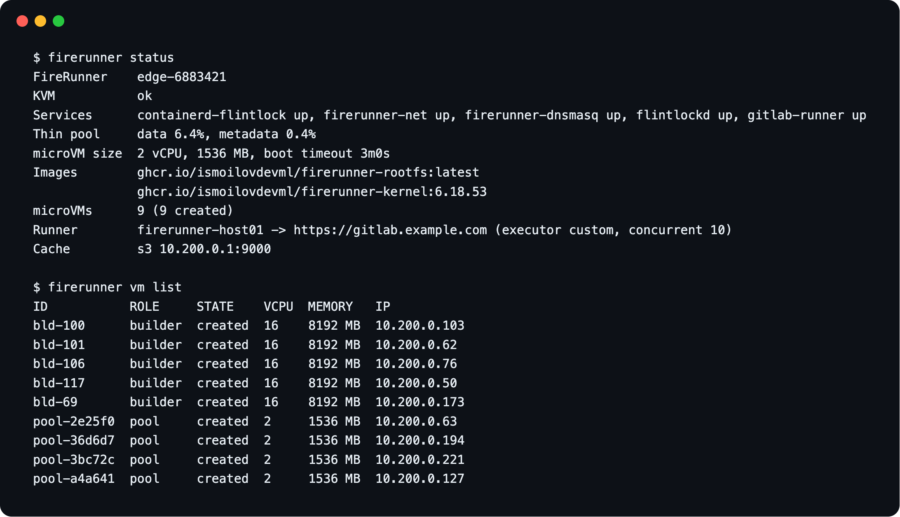

# Operations



## Health

```bash
sudo firerunner status     # one screen: services, disk, VMs, runner
sudo firerunner doctor     # every check, with a hint when one fails
```

## Upgrade

```bash
sudo firerunner upgrade            # latest build of main (edge)
sudo firerunner upgrade --version v1.2.0
```

The release's `checksums.txt` must carry the release signature (Ed25519, key in
`internal/upgrade/release-signing.pub`), the binary must match its checksum and say it is the
version asked for; then it is replaced in place. v0.1.0 and v0.1.1 were published before releases
were signed: `--allow-unsigned` installs them. Running jobs, pre-booted VMs and builders keep
running, so `firerunner upgrade` needs no drain. To upgrade the host stack (containerd,
Firecracker, flintlock, gitlab-runner, network), run the installer again. While jobs run it leaves
the restarts and the gitlab-runner upgrade for a later run; drained, it does them at once:

```bash
sudo firerunner drain              # no new jobs; returns once the running ones finished
curl -sfL https://raw.githubusercontent.com/ismoilovdevml/firerunner/main/install.sh | sudo bash
sudo firerunner undrain            # take jobs again
```

v0.1.1 and older do not check signatures, so their `firerunner upgrade` does not either. For that
one upgrade, run the installer instead (`FR_VERSION=<version>`), which checks it.

After a new guest image is published, replace the idle VMs: `sudo firerunner pool refresh`.

To roll back, restore the previous binary and the `config.yaml` saved before the upgrade: an older
version refuses keys it does not know. v0.1.1 and older cannot talk to flintlockd over TLS: in
`/etc/opt/flintlockd/config.yaml` set `insecure: true`, delete the `tls-` lines and
`systemctl restart flintlockd` when no job runs.

The installer turns on mutual TLS for flintlockd's API in a run when no job runs: flintlockd
restarts with TLS, and firerunner gets the client certificate only once it could list the microVMs
with it; otherwise flintlockd goes back to no TLS. While jobs run it leaves TLS for a later run and
says so. `sudo firerunner doctor` warns while the API runs without TLS and when a certificate
(also the one flintlockd serves) expires within 90 days; a run of the installer renews them and
restarts flintlockd when no job runs.

### Drain

Drain the host before work that would stop running jobs: a reboot, the installer's restarts,
[rebuilding the thin pool](#rebuilding-the-thin-pool). For example (times vary):

```console
$ sudo firerunner drain
drain: the daemon boots no pool VMs and no builders
drain: gitlab-runner takes no new jobs and exits once its running jobs finished
waiting 0s: 2 jobs running, gitlab-runner finishing its jobs
waiting 6m14s: 1 job running, gitlab-runner finishing its jobs
waiting 9m2s: gitlab-runner finishing its jobs
drained: no job runs and gitlab-runner has stopped. Safe to upgrade or reboot;
firerunner undrain takes jobs again (a reboot starts gitlab-runner and ends the drain)
```

- gitlab-runner stops gracefully: it asks GitLab for no new jobs and exits once its running jobs
  finished. No job fails: the ones it did not take stay pending in GitLab, for another runner with
  the same tags or for this host after `undrain`.
- The daemon boots no pool VMs and no builders. Jobs gitlab-runner took before the drain still
  get the ready pool VMs and their project's builder; a job whose project has none builds without
  the layer cache.
- `drain` prints a line whenever what still runs changes, and every minute. It waits at most
  `daemon.job_max_age` plus `daemon.reconcile_interval`, the longest a job can run (`--timeout`).
  A timeout or Ctrl-C ends the wait, not the drain: `drain` again waits again.
- `firerunner status` shows it on the `Drained` line, `firerunner_drained` is 1, and
  `FireRunnerServiceDown` does not fire for the stopped gitlab-runner.
- The drain outlives a daemon restart (`firerunner upgrade`), not a reboot: gitlab-runner starts at
  boot and takes jobs. The installer never starts gitlab-runner on a drained host: it installs a
  new version without starting it, and `undrain` starts it.
- gitlab-runner started during the drain, by hand or otherwise, is stopped again while `drain`
  waits; `status` says when it runs on a drained host.

`sudo firerunner undrain` (or `drain --cancel`) starts gitlab-runner again, if `drain` stopped it,
and lets the daemon boot again. While gitlab-runner still finishes jobs it ran when drained, it
cannot take new ones: it starts again once they are done, and `undrain` waits for that (at most
`--timeout`, by default as long as `drain`) to remove the drain's drop-in below. If that wait ends
first (timeout, Ctrl-C), `undrain` says so and the drop-in stays, so every stop of gitlab-runner
still waits for its jobs; `status` then says `no, but gitlab-runner keeps the drain's stop
settings`. Run `sudo firerunner undrain` again once `systemctl is-active gitlab-runner` no longer
prints `deactivating`. A `drain` meanwhile cancels the start `undrain` queued.

To stop gitlab-runner gracefully, `drain` adds a runtime drop-in,
`/run/systemd/system/gitlab-runner.service.d/zz-firerunner-drain.conf` (`KillMode=mixed`,
`KillSignal=SIGQUIT`, `TimeoutStopSec=infinity`), checks that systemd took it, and stops the unit;
`undrain` removes it once gitlab-runner no longer stops (a reload without it during the stop would
kill the jobs). Without it, `systemctl stop gitlab-runner` sends SIGTERM to every job's processes
and cancels the jobs.

## microVMs

```bash
sudo firerunner vm list            # role: job, pool, builder or run
sudo firerunner vm logs <id>       # guest console, for boot problems (emptied past 64 MiB)
sudo firerunner vm rm <id>
sudo firerunner builder list
```

VMs that no job owns are deleted automatically every minute.

To take no new jobs and wait for the running ones, [drain](#drain) the host: `sudo firerunner drain`.

## Rebuilding the thin pool

A thin pool keeps the chunk size it was created with. A new install uses 64K chunks (`FR_THIN_CHUNK`);
a pool from an older install keeps 512K until it is rebuilt. Check yours with
`sudo lvs -o lv_name,chunk_size,zero flintlock/thinpool`.

A rebuild deletes every microVM disk and the images flintlock pulled; the host pulls the kernel
and root filesystem again on the first boot. It keeps the registry mirrors, the `cache:` store and
the saved builder caches (`/var/lib/firerunner`, on the root disk; the mirrors in their own file
system there, see [Registry mirrors](#registry-mirrors)). Running builders lose what they
cached since their last save. The host takes no jobs while it runs.

1. [Drain](#drain) the host: `sudo firerunner drain`. It returns once no job runs.
2. Stop the daemon, then delete the remaining microVMs. flintlockd deletes in the background:
   repeat `vm list` until it is empty.

   ```bash
   sudo systemctl stop firerunner
   sudo firerunner vm rm --all
   sudo firerunner vm list
   ```

3. Stop the microVM stack and check that no Firecracker process is left:

   ```bash
   sudo systemctl stop flintlockd containerd-flintlock
   pgrep -x firecracker || echo "none left"
   ```

4. Note the pool's disk, then remove containerd's thin devices, the volume group and the old
   state. containerd creates its devices with device-mapper directly, so LVM does not remove them:

   ```bash
   sudo pvs -S vg_name=flintlock -o pv_name --noheadings     # e.g. /dev/sdb
   sudo dmsetup ls --target thin | awk '$1 ~ /^flintlock-thinpool-snap-/ {print $1}' |
       xargs -r -n1 sudo dmsetup remove
   sudo vgremove -y flintlock
   sudo pvremove -y /dev/sdb && sudo wipefs -a /dev/sdb
   sudo rm -rf /var/lib/containerd-flintlock /var/lib/flintlock /run/firerunner/pool.json
   ```

5. Run the installer with that disk; it creates the pool and starts the stack again:

   ```bash
   curl -sfL https://raw.githubusercontent.com/ismoilovdevml/firerunner/main/install.sh | sudo FR_DISK=/dev/sdb bash
   ```

6. Check the new pool and take jobs again:

   ```bash
   sudo lvs -o lv_name,chunk_size,zero flintlock/thinpool   # 64.00k, zero
   sudo firerunner undrain
   sudo firerunner doctor
   ```

A volume group on more than one disk is rebuilt on the first one; add the others afterwards with
`vgextend flintlock /dev/sdX` and grow the pool with `lvextend -L +<size> flintlock/thinpool`.

## Registry mirrors

Each mirror (`docker.io` for Docker Hub, and every `FR_REGISTRY_MIRRORS` host) runs as two services:

| Unit | Listens on | Runs as |
|---|---|---|
| `firerunner-registry@<name>` | `127.0.0.1:<port + 10000>` (15000, 15001, ...) | `firerunner-registry` |
| `firerunner-registry-front@<name>` | the bridge address, port 5000 (Docker Hub) or 5001+ | a dynamic user |

The front (`firerunner registry-front`) passes only pulls (GET and HEAD of `/v2/`, manifests and
blobs) and answers 502 while its registry is down. microVMs use the same ports as before. With a
`firerunner` older than `registry-front`, the registries listen on the bridge ports themselves and
no front runs; the next installer run with a newer one adds them. `firerunner-registry` starts all
of them; `systemctl stop|restart firerunner-registry` stops or restarts all of them. Configs are in
`/etc/firerunner/registries.d/<name>.yml` (registry) and `<name>.env` (front).

When a mirror is down, microVMs pull from the registry itself: slower, and against Docker Hub's
rate limits, but jobs still run.

### Storage

The mirrors keep their data in `/var/lib/firerunner/registries/<name>`, an ext4 file system in
`/var/lib/firerunner/registries.img` on the root disk (`var-lib-firerunner-registries.mount`).
The image is sparse: it takes as much of the root disk as the mirrors store, never more than its
size (`FR_REGISTRY_GB`, by default a fifth of the root file system). Deleted blobs give their space
back to the root disk (`discard`).

```bash
df -h /var/lib/firerunner/registries        # what the mirrors use, of their size
du -sh --apparent-size /var/lib/firerunner/registries.img; du -sh /var/lib/firerunner/registries.img  # size, and what it takes
```

- Grow it: run the installer with a larger `FR_REGISTRY_GB`. It grows online; nothing restarts.
- Shrink it: the installer does not (ext4 shrinks only unmounted). When no job runs:
  `systemctl stop firerunner-registry var-lib-firerunner-registries.mount`, then
  `e2fsck -f /var/lib/firerunner/registries.img && resize2fs /var/lib/firerunner/registries.img <N>G && truncate -s <N>G /var/lib/firerunner/registries.img`,
  then `systemctl start var-lib-firerunner-registries.mount firerunner-registry`. Or delete the
  image (the mirrors start empty) and run the installer with the new `FR_REGISTRY_GB`.
- Another disk: put a file system in `/etc/fstab` on `/var/lib/firerunner/registries`. The installer
  then uses it instead of the image. On a host that already has the image, stop
  `firerunner-registry`, copy the data over, and remove
  `/etc/systemd/system/var-lib-firerunner-registries.mount` (it hides the fstab entry from systemd).

### What frees space

- **ttl**: a mirror deletes what it fetched 7 days ago (`proxy.ttl: 168h`). Earlier versions could
  not (`delete.enabled: false`), so their data never expired; data they fetched is removed only by
  the two below.
- **Eviction**, every 10 minutes (`firerunner-registry-evict.timer`): above 90 % in use, the layers
  read longest ago (to within a day) are deleted until 80 % is in use, across all mirrors. The
  mirrors keep running: a pull of an evicted layer fetches it again. Manifests are never evicted.
- **Garbage collection**, hourly (`firerunner-registry-gc.timer`): at most once a day per mirror and
  only while no job runs, it stops that mirror, runs `registry garbage-collect` and starts it
  again. It removes the blobs no manifest refers to any more.

```bash
systemctl list-timers 'firerunner-registry-*'
journalctl -u firerunner-registry-evict -u firerunner-registry-gc --since -1d
```

A failed garbage collection fails `firerunner-registry-gc` (`systemctl --failed`); it is tried again
the next day, and the eviction still keeps the file system under 90 %.

The daemon's `firerunner_disk_*` metrics do not cover this file system. With node_exporter,
`node_filesystem_avail_bytes{mountpoint="/var/lib/firerunner/registries"}` does. No alert rule
covers it: the eviction keeps it under 90 %, and full only slows pulls.

`firerunner_service_up{service="firerunner-registry"}` (and the alert on it) reports
`firerunner-registry`, which only starts the mirrors: it stays up while one mirror's service fails.
Check them one by one with `systemctl list-units 'firerunner-registry*'`.

### Upgrading from the single service

Hosts installed before this layout ran every mirror in one `firerunner-registry` service as root,
with data in `/var/lib/firerunner/registry` and `/var/lib/firerunner/registry-mirrors` on the root
disk without a limit. The installer moves them in a run when no job runs; while jobs run it leaves
the old service as it is and says so (`firerunner-registry(move)`): run it again when the runner is
idle.

That run:

1. stops `firerunner-registry` (microVMs pull from the registries themselves until step 4);
2. copies each mirror's data into the new file system, if it fits under 80 % of `FR_REGISTRY_GB`
   and the root disk has room for the copy (else that mirror starts empty), and gives it to
   `firerunner-registry`;
3. renames the old directories to `<dir>.migrated` (nothing is deleted);
4. starts every `firerunner-registry@`, `firerunner-registry-front@` and the timers.

It also stops `firerunner-cache` once to give `/var/lib/firerunner/cache` to `firerunner-cache`
(an upload or download of a running job fails; jobs only warn about `cache:`). No other service
restarts for this. A run cut short continues on the next run.

Check, then free the root disk:

```bash
systemctl list-units 'firerunner-registry*'
curl -fsS http://10.200.0.1:5000/v2/ && echo ok      # FR_SUBNET.1
sudo firerunner run -- docker pull alpine
sudo rm -rf /var/lib/firerunner/registry.migrated /var/lib/firerunner/registry-mirrors/*.migrated
```

To go back to the earlier installer version, when no job runs:

```bash
sudo systemctl disable --now firerunner-registry-evict.timer firerunner-registry-gc.timer firerunner-registry
sudo rm -rf /etc/systemd/system/firerunner-registry.service.wants   # else the old service starts the fronts too
sudo mv /var/lib/firerunner/registry.migrated /var/lib/firerunner/registry
for d in /var/lib/firerunner/registry-mirrors/*.migrated; do sudo mv "$d" "${d%.migrated}"; done
```

Then run the earlier installer: it writes its single service again. The renamed-back directories
are still root's, as that service needs (it runs as root without capabilities). What the mirrors
fetched since the move stays in the image.

## Monitoring

Prometheus metrics are on `127.0.0.1:9477/metrics`. To scrape from elsewhere, install with
`FR_METRICS_ALLOW=<prometheus-ip>/32`.

Import the Grafana dashboard and the alert rules from
[`deploy/`](https://github.com/ismoilovdevml/firerunner/tree/main/deploy). Alerts page only for
failures FireRunner or the host caused, never for failing project scripts. Watch:

- **FireRunner failure rate** and **System failures by reason**.
- **Cold boots**: above 20 %, raise `pool.size` (if memory allows).
- **Host resources used**: the fullest host for thin pool, committed memory, DHCP leases and disk.
  A full thin pool or DHCP range stops every new microVM; full memory makes them wait.
- **Committed microVM memory** and **Jobs that waited over 30 s for memory**: jobs queue when
  memory is full.
- **Docker layer cache** row: builders against their slots, why builders were removed, and cache
  copies that fail or are skipped for lack of room.
- **Disk free**: the saved builder caches and flintlock's microVM state.
- **Flintlock errors**: failed flintlock calls by RPC and gRPC code.
- **Corporate proxy** row (hosts with `proxy.enabled`): what became of the forwarder's requests
  (*Proxy requests per second by outcome*), tunnels open, connections against their limits,
  throughput, how long the corporate proxy takes to accept a connection and answer CONNECT, and
  whether it refuses the credentials. The daemon reads these from the forwarder at each scrape;
  *metrics read* at 0 means it could not (the forwarder is down, or its unit predates
  `RuntimeDirectory=firerunner-proxy`: run the installer again).
- **Speed**: *Warm builds* and *Builder boot* (a build that finds its builder booting waits
  for it), *Stage duration p95 by stage* (which part of a job grew).
- **Builder boot by phase** (Docker layer cache row): which part of a builder boot builds wait
  for. `admit` is waiting for host memory, `vm` the VM boot, `save_wait` the previous builder's
  cache copy, `restore` loading the saved cache (it grows with the cache size), `buildkitd` its
  start. The phases add up to the boot. One boot, failed ones too, is one log line with every
  phase's seconds and the total:
  `journalctl -u firerunner | grep 'builder boot phases'`. Its `result` is `ready`, `failed`
  (`failed_phase` names where; a daemon stop that cuts a phase short counts here) or `abandoned`
  (the builder was removed while it booted, or the daemon stopped after its last phase).
- **Node (node_exporter)** row: the host under the microVMs. *CPU steal* (the hypervisor, on a
  host that is itself a VM), *IO wait* and *Pressure stall* show a saturated host before jobs
  fail. It needs node_exporter on the host, with the same `instance` label in both scrape jobs
  (relabel both to the host name): the *Node exporter* variable follows the selected hosts.

The daemon logs one line per job (`journalctl -u firerunner | grep '"job":"<id>"'`).

Logs: `journalctl -u firerunner -u flintlockd -u gitlab-runner`.

## Alerts

Each rule in `deploy/prometheus/firerunner-alerts.yml` links to its section here. Names in
*italics* are panels of the Grafana dashboard.

### FireRunnerDaemonUnhealthy

Critical. The daemon is not scraped, or its main loop has not passed for 2 minutes. Jobs still
run, but every one cold-boots, nothing is cleaned up and the other FireRunner alerts are blind.

- Check: `journalctl -u firerunner -n 200`. Before restarting, check what the loop may wait on,
  which a restart does not fix: `systemctl status flintlockd` and
  `sudo timeout 10 lvs flintlock/thinpool` (a hang means LVM or the disk is stuck).
- Fix: `sudo systemctl restart firerunner`.
- Recovered: `curl -s 127.0.0.1:9477/healthz` on the host prints `ok`.

### FireRunnerFlintlockDown

Critical. The daemon has not reached the flintlock API for 3 minutes: no microVM can be created and
every new job fails in prepare.

- Check: `systemctl status flintlockd containerd-flintlock`, `journalctl -u flintlockd -n 100`,
  `sudo firerunner doctor`. flintlockd needs `containerd-flintlock`.
- Recovered: *Flintlock API* is up and the next job gets a microVM.

### FireRunnerServiceDown

Critical. `flintlockd`, `containerd-flintlock`, `firerunner-net`, `firerunner-dnsmasq` or
`gitlab-runner` has been inactive for 3 minutes: jobs fail (no microVM, network or DHCP) or are not
taken from GitLab.

- Not for gitlab-runner while the host is [drained](#drain): `firerunner drain` stops it on purpose.
- Check: `journalctl -u <service> -n 100`, `sudo firerunner doctor`.
- Fix: `sudo systemctl start <service>`. Never restart `firerunner-net` while jobs run: stopping it
  removes the bridge; its rules reload with `systemctl reload firerunner-net`.
- Recovered: *Services* shows it up.

### FireRunnerCacheServiceDown

Warning. `firerunner-registry` (it starts the registry mirrors) or `firerunner-cache` (`cache:`
storage) has been down for 10 minutes. Jobs still run, but pull from the registries directly
(Docker Hub rate limits) or start without their `cache:`. One mirror's failing service does not
fire it: see [Registry mirrors](#registry-mirrors).

- Check: `journalctl -u <service> -n 100`; for the mirrors `systemctl list-units 'firerunner-registry*'`,
  `df -h /var/lib/firerunner/registries` and `systemctl status var-lib-firerunner-registries.mount`
  (the mirrors do not start without their file system).
- Fix: `sudo systemctl start <service>` (`firerunner-registry` starts every mirror).
- Recovered: *Services* shows it up, and `systemctl list-units 'firerunner-registry*'` shows every
  mirror and front `active`.

### FireRunnerProxyDown

Critical. Only on hosts with `proxy.enabled`. `firerunner-proxy` has been inactive for 3 minutes:
microVMs, builders, `gitlab-runner`, `containerd-flintlock` and the registry mirrors reach the
outside through it, so jobs fail on pulls, clones and downloads (hosts in `proxy.no_proxy` still
work).

- Check: `journalctl -u firerunner-proxy -n 100`, `sudo firerunner doctor`. A 407 there means the
  corporate proxy refused the credentials in `proxy.upstream_file`.
- Fix: `sudo systemctl start firerunner-proxy`; after a credential change, update the upstream file
  and `sudo systemctl restart firerunner-proxy`.
- Recovered: *Services* shows it up and the next job's pulls succeed.

### FireRunnerProxyUpstreamAuthFailing

Critical. Only on hosts with `proxy.enabled`. The corporate proxy has refused the credentials in
`proxy.upstream_file` (`/etc/firerunner/proxy-upstream`) with a 407 for 10 minutes: the password
expired or was changed, or the account is locked. Every pull, clone and download of jobs,
builders, `gitlab-runner` and the registry mirrors through the proxy fails with 502; hosts in
`proxy.no_proxy` still work. The forwarder sends refused credentials again only once every
5 minutes, so it does not lock the account further; a one-off refusal clears at that retry,
before the alert fires.

- Check: `journalctl -u firerunner-proxy | grep 'refused the credentials'`; *Upstream credentials
  and file* shows *credentials refused* at 1.
- Fix: `sudoedit /etc/firerunner/proxy-upstream` with the new password, %-encoded (see
  [A proxy with a password](corporate-network.md#a-proxy-with-a-password)). The next request uses
  it, no restart; *file changes ok* counts it.
- Recovered: the next request the proxy accepts sets *credentials refused* to 0. With no job
  running, `sudo firerunner doctor` makes one (*HTTPS through the proxy*).

### FireRunnerProxyUpstreamErrors

Warning. Over 10 % of the requests that went to the corporate proxy in 10 minutes, and at least
10, failed there: it is unreachable, does not answer CONNECT within 15 s or a request at all, or
the upstream file is unusable (wrong owner or mode, not a proxy URL). The forwarder answers 502,
and jobs fail on pulls, clones and downloads. Sites the corporate proxy blocks
(`upstream_refused`) and refused credentials have their own outcomes and do not count.

- Check: `sudo firerunner doctor` (*upstream reachable*, *HTTPS through the proxy*);
  `journalctl -u firerunner-proxy | grep -E 'upstream proxy (unreachable|did not answer|did not take)|no upstream'`.
  *Proxy requests per second by outcome* shows when it started; *Upstream connect time* whether
  the proxy got slow first.
- Fix: a new proxy address goes in `/etc/firerunner/proxy-upstream` (no restart). Otherwise the
  corporate proxy or the network to it is down: its owners fix it.
- Recovered: `upstream_error` stays at 0 in *Proxy requests per second by outcome*.

### FireRunnerProxyAtLimit

Warning. For 5 minutes the forwarder's connections have been over 80 % of a limit, or it refused
requests (503) for one in the last 10 minutes. The limits: 256 per microVM
(`busiest_microvm`), 4096 for all microVMs (`microvms`), 1024 for host services such as
`gitlab-runner`, `containerd-flintlock` and the registry mirrors (`host`). Past a limit requests
get 503 and jobs fail on downloads.

- Check *Proxy connections against their limit* for the scope. `busiest_microvm`: one job opens
  many connections at once (parallel downloads, a test that does not close its connections);
  `journalctl -u firerunner-proxy | grep 'too many connections'` names the client address and
  `sudo firerunner vm list` the job's VM.
- Fix: the job's own downloads (fewer in parallel, reuse connections). `microvms`: lower
  `concurrent`. The limits are fixed in the forwarder.
- Recovered: the share is below 80 % and no request was refused for 10 minutes.

### FireRunnerSystemFailures

Critical. In 30 minutes at least 3 jobs, and over 5 % of all jobs, failed because of FireRunner or
the host. Failing project scripts and cancelled jobs do not count.

- Check the `reason` in *System failures by reason*: `ssh_lost` a microVM died, usually a host OOM
  kill (see [FireRunnerHostOOMKill](#firerunnerhostoomkill)); `vm_boot` DHCP or the guest boot
  (`firerunner vm logs <id>`); `flintlock_error` flintlockd or the thin pool; `admission_timeout` no
  host memory (or a busy admission lock) within `vm.boot_timeout`; `services`, `docker_auth`, `helper_stage` the job log says
  which step. Per job: `journalctl -u firerunner | grep '"result":"system_failure"'`.
- Recovered: the alert resolves once fewer than 3 such failures are left in the last 30 minutes.

### FireRunnerJobsWaitForMemory

Warning. In 30 minutes at least 3 jobs, and over 10 % of prepared jobs, waited more than 30 s for
host memory before their microVM was created.

- Check *Committed microVM memory by role*: more `job` memory than the running jobs need means
  leaked VMs (`firerunner vm list`); a large `builder` share means `builder.max` or
  `builder.memory_mb` is too high.
- Fix: otherwise lower `concurrent` or `pool.size`, or add memory.
- Recovered: *Jobs that waited over 30 s for memory* stays at 0.

### FireRunnerHostOOMKill

Warning. The kernel OOM-killed a process in the last 10 minutes, usually a firecracker microVM:
its job failed with `ssh_lost`, or its builder died.

- Check what was killed and how large it was:
  `journalctl -k --since -15min | grep -iE 'out of memory|killed process'`.
- Fix: admission keeps microVM memory below MemTotal minus `vm.host_reserve_mb`, so the host needed
  more than that reserve: raise it (`sudo firerunner config set vm.host_reserve_mb <MB>`), or lower
  `concurrent`, `pool.size` or `builder.max`.
- Recovered: no new kill; the alert resolves 10 minutes after the last one.

### FireRunnerThinPoolFull

Warning. The devmapper thin pool that holds every microVM disk was over 85 % (data) or 75 %
(metadata) full at a reading in the last 15 minutes. From 95 % data or 90 % metadata no new
microVM starts (jobs, pool VMs and builders wait for room, then fail as `admission_timeout`):
running microVMs keep writing to their disks, and at 100 % every one of them fails; full metadata
can damage the pool.

- Check: `sudo lvs flintlock`; `firerunner vm list` for VMs that should be gone.
- Fix now: `sudo firerunner builder rm --all` frees the builder VMs' disks, but also deletes every
  project's saved layer cache, so every next build is cold.
- Fix for good: more space in the volume group (`vgextend flintlock <disk>`), then
  `lvextend -l +100%FREE flintlock/thinpool` for data or
  `lvextend --poolmetadatasize +<size> flintlock/thinpool` for metadata.
- Recovered: *Thin pool usage* is below the threshold; the alert resolves 15 minutes later.

### FireRunnerThinPoolUnknown

Warning. The daemon runs, but has not read the thin pool usage for 25 minutes, so
[FireRunnerThinPoolFull](#firerunnerthinpoolfull) cannot fire.

- Check on the host: `sudo timeout 10 lvs flintlock/thinpool`. An error or a hang means LVM or the
  disk is in trouble (`dmesg -T | tail -50`). The daemon logs its own `lvs` error:
  `journalctl -u firerunner | grep 'thin pool usage'`.
- Recovered: *Thin pool usage* shows data again.

### FireRunnerDHCPLeasesExhausting

Critical. Over 80 % of the microVM DHCP range has been leased for 5 minutes. At 100 % new microVMs
get no address and jobs fail with `got no DHCP lease`.

- Check *DHCP leases*: mostly `live` means that many microVMs exist (lower `concurrent` or
  `pool.size`); mostly `stale` means leases of deleted VMs are not released: install
  `dnsmasq-utils` (`dhcp_release`) and check `journalctl -u firerunner | grep 'delete failed'`.
- Recovered: *Host resources used* shows DHCP leases below 80 %.

### FireRunnerDiskFilling

Warning. The file system of `/var/lib/firerunner/builder-cache` or `/var/lib/flintlock/vm` has had
less than 15 % free for 15 minutes. Below 10 % no builder cache is saved; at 0 `cache:` uploads
and flintlockd's microVM state can no longer be written. The registry mirrors take at most
`FR_REGISTRY_GB` of it ([Registry mirrors](#registry-mirrors)).

- Check: `df -h /var/lib/firerunner /var/lib/flintlock/vm`;
  `sudo du -xsh /var/lib/firerunner/* /var/lib/flintlock/vm`.
- Fix: `cache:` archives: run the installer again with a lower `FR_CACHE_DAYS`. Saved builder
  caches: lower `builder.saved_cache_gb` (applies at the next save);
  `sudo firerunner builder rm --all` deletes every project's saved cache at once, so every next
  build is cold.
- Recovered: *Disk free* is above 15 % of the file system.

### FireRunnerBuildersFailing

Warning. In the last hour at least 3 builders failed to boot, stopped answering or lost their VM.
Those projects' `docker build` runs without the layer cache, or fails when its builder dies.

- Check: `journalctl -u firerunner --since -1h | grep -E 'builder boot failed|builder: (not answering|VM gone)'`.
- Fix: `no host memory for a builder` means builders do not fit next to the jobs: lower
  `builder.max` or `builder.memory_mb`. Not answering or VM gone: usually the builds of one project
  filled the builder's memory: lower `builder.max_parallelism` or raise `builder.memory_mb`.
- Recovered: *Builder removals by reason* shows no `not_answering` or `vm_gone`; the alert resolves
  an hour after the last one.

## Services

| Unit | Role |
|---|---|
| `firerunner` | daemon: pool, builders, cleanup, metrics |
| `flintlockd`, `containerd-flintlock` | start and stop microVMs; store their images |
| `firerunner-net`, `firerunner-dnsmasq` | microVM network, DHCP and DNS |
| `firerunner-registry` | starts the registry mirrors for the VMs (Docker Hub and `FR_REGISTRY_MIRRORS`) |
| `firerunner-registry@<name>`, `firerunner-registry-front@<name>` | one mirror, and its pull-only front on the bridge; see [Registry mirrors](#registry-mirrors) |
| `firerunner-registry-evict.timer`, `firerunner-registry-gc.timer` | keep the mirrors' file system under 90 %; remove blobs no image uses |
| `firerunner-cache` | storage for `cache:` |
| `gitlab-runner` | takes jobs from GitLab |

Back up `/etc/firerunner`, `/etc/opt/flintlockd` and `/etc/gitlab-runner/config.toml`. Everything
else can be rebuilt.

## Troubleshooting

Start with `sudo firerunner doctor`. For an alert, see its section under [Alerts](#alerts).

| Symptom | Fix |
|---|---|
| installer: `/dev/kvm not found` | turn on virtualization or nested virtualization |
| installer: `no blank disk found` | attach an empty disk or set `FR_DISK` |
| jobs stay pending | the job needs `tags: [firecracker]`; check the runner is online in GitLab |
| `got no DHCP lease` | `systemctl status firerunner-net firerunner-dnsmasq`; then `firerunner vm logs <id>` |
| `waiting for host memory` for long | fewer parallel jobs, a smaller `pool.size`, or more RAM; `firerunner_memory_committed_bytes` shows who holds it |
| firewall rules need re-applying | `systemctl reload firerunner-net`; never restart it while jobs run, stopping it removes the bridge |
| jobs cannot reach an internal host | its network overlaps `10.200.0.0/24` or the VM Docker ranges; change `FR_SUBNET` or `vm.docker_bip` |
